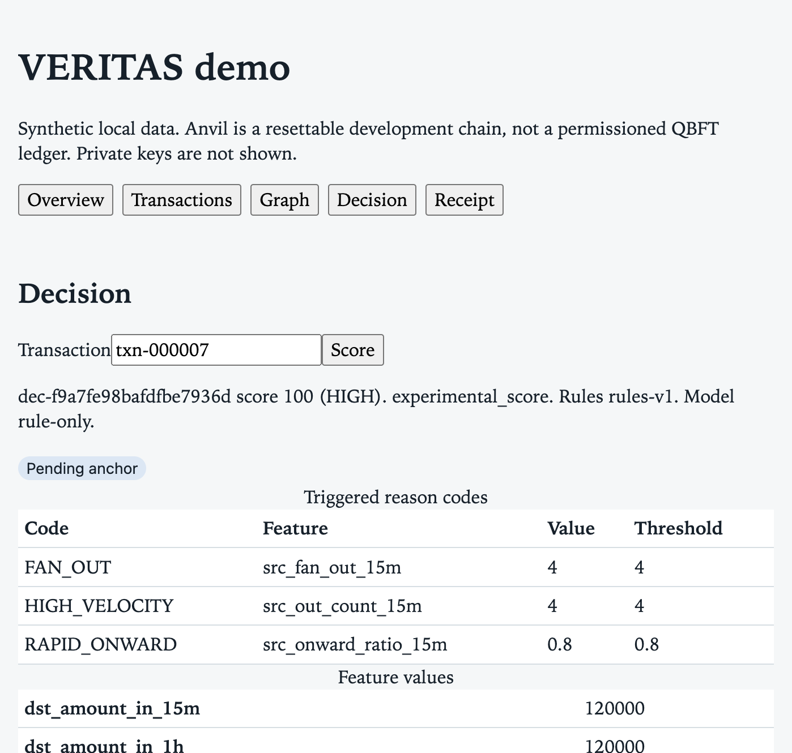
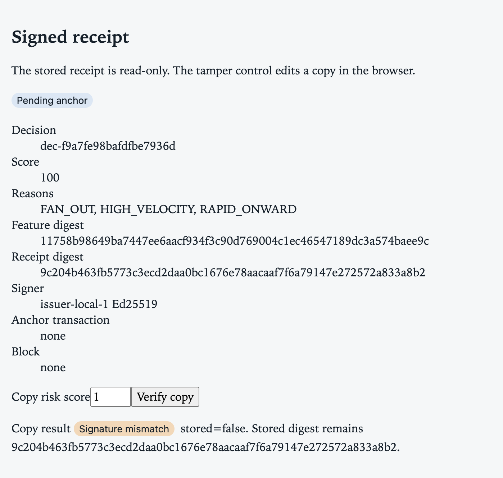

# VERITAS

Local prototype for synthetic fraud-network scoring, signed decision evidence, and an integrity check against one **local Anvil** development chain.

Three logical simulated banks share one application. The data is synthetic. Anvil is a resettable local EVM. It is not a permissioned QBFT ledger, there is no four-validator Besu network, and the nodes are not independent institutions. The experimental score is not a production fraud claim. No real banking data, and no employer data, is in this repository.



## Platform requirements

| Item | Requirement |
|---|---|
| Machine | Apple Silicon Mac (arm64). Developed and measured on a MacBook Pro M1 with 8 GB of unified memory |
| OS | macOS. Recorded run: `macOS-26.6.2-arm64` |
| Python | CPython **3.14** (`requires-python >=3.14,<3.15`). Recorded: Homebrew 3.14.2 |
| Node | **24**. Recorded: v24.22.0 (Homebrew `node@24`), npm 11.19.1 |
| Foundry | **1.8.5** (`anvil`, `forge`, `cast`) in `~/.foundry/bin`. Install record and checksum are in `docs/ENVIRONMENT.md` |
| Not needed | Podman, Docker, Besu, PostgreSQL, Redis, Kafka, Neo4j |

Everything runs as native macOS processes bound to `127.0.0.1`. The API refuses non-loopback bind hosts and a non-loopback chain RPC.

**8 GB note.** On the recorded machine swap was already heavily used. Start one heavy process at a time. Do not run the API, Anvil, a browser, and `make benchmark` together. `make test-e2e` and `make benchmark` start their own temporary Anvil on port 8545, so that port must be free.

**x86 users.** GitHub Actions runs the unit, frontend, and Foundry tests on x86_64 Linux. Python and Node dependencies are pinned and have x86 wheels, but the benchmarks, screenshots, and live chain evidence in this repository were produced on arm64 and have not been repeated on x86.

## Setup

```bash
make setup           # creates .venv from Homebrew python3.14, installs pinned backend dependencies
make test-unit       # backend unit tests
make lint            # ruff
make format-check
make contract-test   # forge test (installs forge-std v1.9.6 into contracts/lib on first run)
(cd frontend && npm ci)   # once; installs the locked frontend packages
make frontend-test   # vitest
make frontend-build  # tsc --noEmit and vite build
```

`make setup` installs `backend[dev]` with exact pins from `backend/pyproject.toml`. `backend/requirements.lock` records the full resolved set, including transitive dependencies. If `/opt/homebrew/bin/python3.14` is elsewhere, run `make setup PYTHON=/path/to/python3.14`.

## Startup order

Use a separate terminal for each long-running process. Leave port 8545 free unless you are running the chain.

1. `make seed` if `data/veritas.db` is missing (seed 42, default scale).
2. `make backend` on `127.0.0.1:8000`.
3. `make frontend` on `127.0.0.1:5173`.
4. Optional chain path, in this order: `make chain-start`, then `make contract-deploy` (writes the gitignored `.env.local`), then `make worker`.

Without step 4 the dashboard works, and receipts stay `Pending anchor`. That is the honest state, not an error.

## Scenario / demo command

Seed 42 at the default scale writes 3 banks, 300 accounts, and 2,000 transfers. `txn-000007` is the seeded cross-bank fan-out.

```bash
curl -sS http://127.0.0.1:8000/api/v1/health
curl -sS -X POST http://127.0.0.1:8000/api/v1/decisions/evaluate \
  -H 'Content-Type: application/json' \
  -d '{"transaction_id":"txn-000007","idempotency_key":"demo-fan-out"}'
```

Expected on a fresh seed-42 database: decision `HIGH`, score 100, reason codes `FAN_OUT`, `HIGH_VELOCITY`, `RAPID_ONWARD`, and the feature snapshot digest `11758b98649ba7447ee6aacf934f3c90d769004c1ec46547189dc3a574baee9c` (recorded in `docs/STATUS.md`, Phase 03). The same idempotency key returns the stored decision. Transaction responses omit ground-truth labels. The dashboard receipt is read-only. Its tamper control edits a browser copy and posts it to `POST /api/v1/verify`.

## Reproducible fixtures

| Fixture | How to reproduce |
|---|---|
| Synthetic dataset | `make seed` (seed 42). The default scale reports `content_sha256` `cd1955ac9585643c7f67a7e12abc65dcfd905f135db7e21ef1f1d41680dc5ca0`. `make seed REPLACE=1` rebuilds demo rows and must give the same hash |
| Scales | tiny 100 accounts / 500 transfers, default 300 / 2,000, benchmark 1,000 / 10,000 (`make seed SCALE=benchmark CONFIRM=1`) |
| Rules manifest | `docs/rulesets/rules-v1.json`. `make ruleset-manifest` reports canonical RFC 8785 SHA-256 `5cfa632b350438ea23f0fe7842efeb8f85f52bfd5830e060012019bb52e4b655` |
| Contract builds | Pinned in `contracts/fixtures/*.build.json` (runtime SHA-256 hashes below) |
| On-chain replay & ingest | `make onchain-replay && make onchain-ingest` populates `data/veritas-onchain.db`. The `(id, from, to, amount, time)` SHA-256 fingerprint matches the off-chain source exactly |
| Raw benchmarks | `docs/benchmarks/study.json` (Phase 08) and `docs/benchmarks/onchain_benchmark.json` (Phase 10) |
| Live tamper transcript | `make capture-tamper` writes `docs/publication/tamper-cli-live.txt` |

## Screenshots

Images in `docs/publication/images/` were captured from the running dashboard against the seed-42 database. To retake them:

1. Complete `make seed`, `make backend`, and `make frontend` (steps 1–3 above). Skip the chain for the screenshots.
2. Open `http://127.0.0.1:5173`.
3. Capture **Overview**, then **Decision** after scoring `txn-000007`, then **Receipt** after entering a copy score and pressing *Verify copy*. For the truncation warning, load the graph for `txn-000500`.
4. Save under `docs/publication/images/` only after the page shows live data. Do not capture a page that shows an error.

`docs/publication/storyboard.md` maps each demo scene to the artifact that backs it.

## Stop and cleanup

Stop each process with Ctrl-C (frontend, worker, API, Anvil), then confirm the ports are free:

```bash
lsof -nP -iTCP:8000 -sTCP:LISTEN
lsof -nP -iTCP:5173 -sTCP:LISTEN
lsof -nP -iTCP:8545 -sTCP:LISTEN
```

No output means free. Optional cleanup of project-owned local state: `rm -rf data/veritas.db data/veritas-onchain.db .anvil .local/keys frontend/dist`. These paths are gitignored, and deleting them erases the synthetic dataset, local commitments, and the issuer key. Do not delete paths this project did not create. The outage procedure is in `docs/RUNBOOK.md`.

## Architecture and documents

| Document | Contents |
|---|---|
| `docs/ARCHITECTURE.md` | Mermaid topology, sequence diagrams, design spec, trust-boundary diagram, and on-chain intelligence architecture (section 16) |
| `docs/THREAT_MODEL.md` | What is trusted, what is not, ruleset tampering, Anvil reset detection, and data privacy boundary |
| `docs/RUNBOOK.md` | Operating, outage, cleanup, ruleset registration, and on-chain replay/ingest procedures |
| `docs/API.md`, `docs/openapi.json` | HTTP endpoints and the generated OpenAPI 3.1 document (including ruleset and provenance endpoints) |
| `docs/PROTOCOL.md` | Evidence protocol 1.1, ruleset commitments, source_ref provenance, verifier statuses, contract identity |
| `docs/adr/` | SQLite (ADR-001), native Anvil instead of Besu (ADR-002), async outbox (ADR-003), Ruleset Registry (ADR-004), On-chain transfer log (ADR-005) |
| `docs/STATUS.md`, `docs/ACCEPTANCE.md` | Delivery state and acceptance results |

The contract chain id is **31337**. The pinned runtime bytecode SHA-256 hashes (solc 0.8.28, optimizer 200 runs) are:
- `DecisionRegistry`: `9bef8ceb9b4888b3d31ab6c0e073cd34301145be187548e308e755a10f8978db` (1,273 bytes)
- `RulesetRegistry`: `8fbbb76dcc547f0cbc6038baa5ce45d88c7ebe2115ea3f4bb9639932efca6ccf` (1,348 bytes)
- `TransferLog`: `4a41fe0b568d01924f4effa8de9be0be57170ae660c928a9bdaf0b8b36aa4c3d` (1,080 bytes)

## Signing, commitments, and on-chain intelligence

The receipt is RFC 8785 JSON, SHA-256, and Ed25519 over those canonical bytes (Protocol 1.1). The public key is pinned beside the gitignored private key.
- **Decision anchoring:** The chain stores only the decision-key digest and the evidence digest in `DecisionRegistry.sol`.
- **Ruleset verification:** The active ruleset manifest digest (`ruleset_sha256`) is registered in `RulesetRegistry.sol`, allowing the verifier to distinguish legitimate rule executions from unauthorized or tampered rule sets.
- **On-chain event logging:** `TransferLog.sol` records pseudo-anonymized transfers without scenario labels or feature vectors. The backend replay/ingest pipeline populates an isolated `data/veritas-onchain.db`, enabling downstream analytics and proving transaction execution block/tx provenance (`source_ref`) on decisions and receipts.

`make verify RECEIPT=... TRUSTED_KEYS=...` checks a receipt file independently without calling the scoring API. A stopped Anvil returns `VERIFICATION_UNAVAILABLE`.



Independent CLI evidence: `docs/publication/tamper-cli-live.txt` shows one receipt returning `VERIFIED_ONCHAIN`, a copy with `risk_score` changed from 100 to 1 returning `TAMPERED`, a wrong contract address returning `CONFIG_MISMATCH`, and the original returning `VERIFICATION_UNAVAILABLE` once Anvil stopped. This shows integrity of the receipt. It does not show that a decision was correct.

Anvil's sample accounts are public insecure credentials. See `SECURITY.md`.

## Benchmarks

`make benchmark` is the explicit 10,000-transaction run. The study generated at `2026-10-20T06:25:13Z` is in `docs/benchmarks/`. On that run, seed-42 default graph scoring was p50 6.175 ms and p95 10.109 ms (15 samples after 2 warm-ups). The 1,000-account / 10,000-transaction generation was p50 171.542 ms (one sample). One anchor confirmation was 60.161 ms. Peak RSS was 81,543,168 bytes. The rule-only tiny-set precision was 0.0084 and recall was 0.25 (`docs/RISK_REPORT.md`): 353 of the 356 flagged transfers were legitimate, because ordinary accounts also reach the count thresholds inside that burst. These are single-machine, synthetic, experimental results.

The on-chain benchmark (`docs/benchmarks/onchain_benchmark.json`) measured replay and ingestion of 300 accounts and 2,000 transfers against local Anvil across 3 runs: mean replay duration was 53.7 ms, mean ingestion duration was 49.9 ms, and peak RSS was 43.5 MB.

## Reproducibility and checks

Local Anvil integration is `make test-e2e` and `make capture-tamper`. It is **not** part of the GitHub Actions workflow, which runs Python unit tests, frontend tests and build, and Foundry tests only. A clean-checkout run in a temporary directory has not been performed yet. It waits for the maintainer's approval (see `docs/STATUS.md`).

Deleting `.anvil/` erases local commitments. A restart without that state file starts empty. That reset is not durable evidence.

## Scope and limitations

- Not a four-validator Besu QBFT network. One native Anvil process, one operator.
- No institutionally independent nodes. A single person controls the signer, database, worker, and chain.
- Synthetic dataset and synthetic labels. No real banking, customer, or employer data.
- The score is experimental. This is not a production fraud detector and makes no production accuracy claim.
- A holder of the issuer key can re-sign altered content. A local chain commitment does not change that.

## License and contributions

MIT, see `LICENSE`. Third-party notices are in `docs/publication/THIRD_PARTY.md`. Security reports and the secret-scan commands are in `SECURITY.md` and `docs/publication/SECRET_SCAN.md`. Contribution limits are in `CONTRIBUTING.md`. The draft release notes are `docs/publication/RELEASE_NOTES.md`. The LinkedIn follow-up draft is `docs/publication/linkedin-followup.md`.
