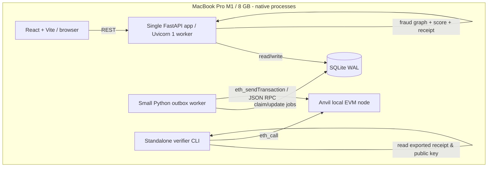
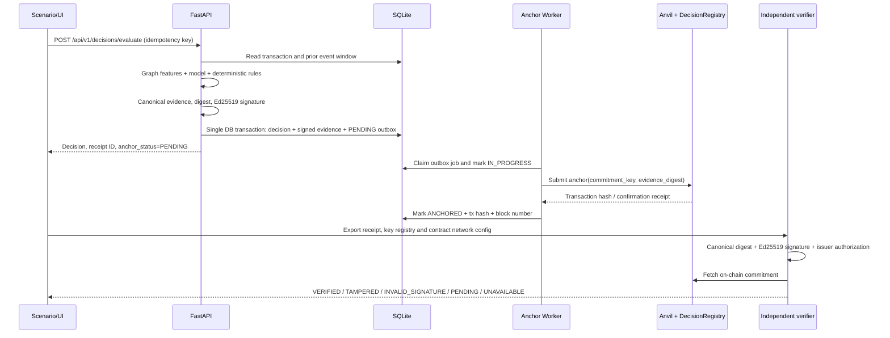
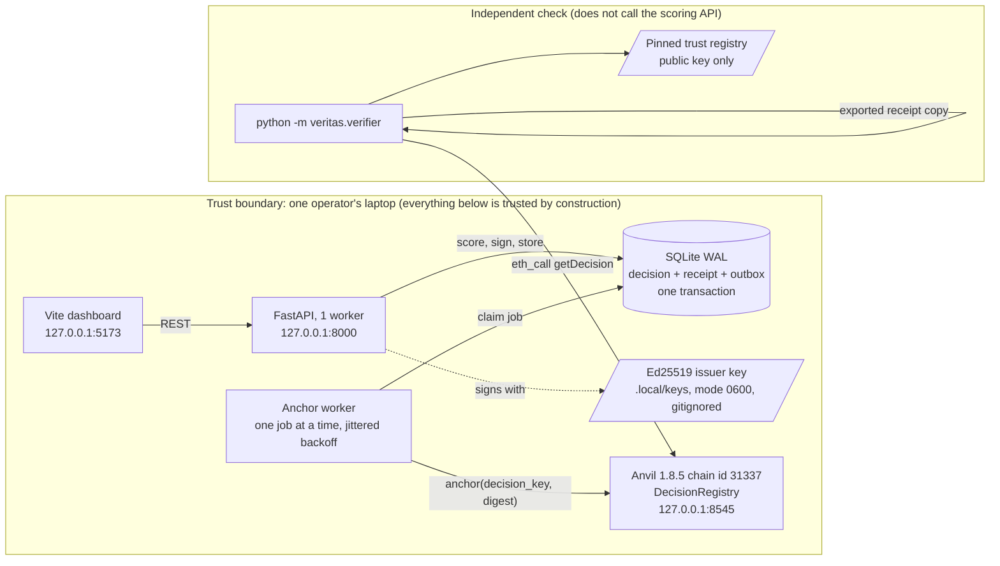

# VERITAS Core MVP — Solution Architecture (M1/8 GB Edition)

## 1. Purpose and falsifiable hypothesis

Given deterministic **synthetic** payments from three logical simulated banks, the system should (a) detect injected mule-network patterns with reproducible graph + hybrid scoring; (b) issue reproducible, signed risk-decision evidence; (c) anchor a digest of the evidence into a **local** EVM contract; and (d) allow an independent CLI to detect tampering without trusting the fraud-scoring API.

It must also quantify what a local blockchain adds or costs compared with a conventional signed, database-backed decision log. Demonstrating “a hash written to a chain” alone is inadequate proof of cross-institution trust.

## 2. Scope / non-goals

IN: deterministic simulator; graph analytics; lightweight anomaly detector; versioned deterministic scoring; decisions + reasons; canonical receipt; Ed25519 signature; SHA-256 digest; one local Anvil EVM; append-only smart contract; robust SQLite outbox and retries; independent verifier; modest React dashboard; measured baseline comparison; reproducible tests, documentation and short demo.

OUT: private multi-party ledger governance, four Besu validator nodes, federated learning, customer PII, real banking data, LLM inference, general-purpose CEP, Kafka, Redis, Celery, Neo4j, managed cloud, elaborate IAM, zero-knowledge proof, banking-grade KYC and real-time payment authorization.

## 3. Local runtime topology



Target *development deployment*: Python, Node/Vite and Anvil executed directly on macOS, without Podman running. All RPC and HTTP endpoints default to localhost. The verification CLI may share a vetted small crypto utility library but must not ask the scoring API whether a decision is valid.

## 4. Module/component model

| Module | Responsibilities | Suggested files |
|---|---|---|
| `simulator` | seeded banks, accounts, transfers, hidden labels, scenario manifests | `backend/veritas/simulator/` |
| `storage` | sqlite schema, migrations, transactions, read models, outbox | `backend/veritas/storage/` |
| `graph` | event window to NetworkX DiGraph/MultiDiGraph, bounded feature extraction | `backend/veritas/graph/` |
| `risk` | controlled training and inference, deterministic rules, scores/reason codes | `backend/veritas/risk/` |
| `decisions` | orchestration, idempotency, persist result + evidence | `backend/veritas/decisions/` |
| `evidence` | canonical JSON (RFC 8785), SHA-256, Ed25519, key IDs, schema | `backend/veritas/evidence/` |
| `ledger` | EVM client, anchor job, finality/status tracking, retry | `backend/veritas/ledger/`, `backend/veritas/workers/` |
| `verifier` | independent CLI with explicit trust store and status taxonomy | `backend/veritas/verifier/` |
| `api` | FastAPI routes, Pydantic contracts, HTTP errors and correlation IDs | `backend/veritas/api/` |
| `dashboard` | transaction view, graph panel, decision receipt, verifier interface | `frontend/` |
| `contract` | `DecisionRegistry.sol`, Foundry tests/deployment | `contracts/` |

IMPORTANT: these are logical modules, **not** 11 processes or containers. Risk model loads lazily and is cached; background anchoring runs as a separate small Python process for the outage demonstration. All other Python modules run in one API process or CLI invocations.

## 5. Runtime sequence and data states



Outbox jobs MUST be idempotent. If transaction submission succeeds and the worker crashes before marking the job completed, resubmission must detect the existing commitment and mark the job ANCHORED. For the MVP, avoid unreliable in-process `BackgroundTasks` as the sole durability mechanism.

## 6. Minimal persisted data schema

- `banks`: `bank_id` PK, display name.
- `accounts`: opaque synthetic account ID PK, bank FK, opening time.
- `transactions`: unique transaction ID, from/to account, amount as **integer minor currency units**, event time (UTC), currency, optional scenario reference; never reveal ground-truth label to scorer.
- `scenario_ground_truth`: scenario ID, transaction ID/account ID, label; **evaluation-only**, excluded from scoring queries.
- `feature_snapshots`: snapshot ID, transaction ID, schema version, canonical feature payload and digest.
- `decisions`: decision ID, request idempotency key, transaction ID, risk score, decision category, reason codes, model version, ruleset version, created UTC timestamp.
- `evidence_receipts`: decision FK, canonical bytes/string, SHA-256 digest, Ed25519 detached signature, public key ID, signing algorithm, created UTC timestamp.
- `anchor_outbox`: job ID, decision FK UNIQUE, status, attempts, next retry, submitted tx hash, block number, error category, timestamps.
- `chain_config`: chain ID, registry address, deployment tx hash, locally pinned signer allowlist metadata.
- SQLite PRAGMA foreign_keys=ON, journal_mode=WAL, busy_timeout, controlled connection lifetimes and short write transactions.

## 7. Risk scoring design

- Bounded, time-filtered graph (no future-event leakage); compute features for source/destination around each evaluated event: 15-minute and 1-hour transaction counts, incoming/outgoing degree, amounts, rapid onward transfers, fan-in/fan-out and multi-hop reachability. Missing values explicit.
- Deterministic rules (versioned config). ML optional to decision: scikit-learn `IsolationForest` on numeric features and a **distinct training dataset**. Fit once and persist the artifact with hash and training seed; do not retrain for each API call.
- Simple experimental score (not calibrated probability) = `0.6 * normalized_anomaly_score + 0.4 * rule_score`. Fix and document normalization from a training reference distribution; do not use batch-dependent min-max scaling at prediction time. Rules and model version included in signed receipt.
- Initial thresholds: LOW 0-39, REVIEW 40-69, HIGH 70-100. Label HIGH not "fraud proven". Tune thresholds based on held-out synthetic scenarios. Report precision/recall/false positives with full synthetic-data caveat.
- Reason codes derived only from actual triggered rules/features. Never claim causal explainability from IsolationForest feature values alone.

## 8. Evidence contract (v1)

Canonical payload (example values are placeholders; implement data validation):

```json
{
  "schema_version": "1.0",
  "decision_id": "dec-001",
  "transaction_id": "txn-001",
  "bank_id": "BANK_A",
  "decision": "REVIEW",
  "risk_score": 68,
  "reason_codes": ["HIGH_VELOCITY", "FAN_OUT"],
  "feature_snapshot_sha256": "<64 lowercase hex characters>",
  "model_version": "iforest-v1",
  "ruleset_version": "rules-v1",
  "decision_timestamp": "2026-10-19T14:00:00Z"
}
```

The *signed material* must be defined unambiguously: canonicalize the above payload as RFC 8785 JSON bytes; `digest = SHA256(canonical_bytes)`; Ed25519 sign **canonical_bytes** (choose canonical bytes rather than digest so verifier never misinterprets what was signed). Receipt wrapper includes `payload`, `digest_hex`, `signature_b64`, `signing_key_id`, `signature_algorithm`. `key_id` resolves to a trusted pinned public key in an issuer trust file distributed separately from the receipt. The verifier must not trust a public key supplied only inside an untrusted receipt. Run test vectors including key reorder, floating-point precision/NaN, Unicode, altered fields, invalid signature.

On-chain only `decision_key = SHA256("VERITAS:DECISION:" || decision_id_bytes)` and `evidence_digest` bytes32, issuer or anchor address, block/event metadata; **no account IDs or raw evidence on chain**. Decision IDs must be random and non-personal; hash commitment is not privacy guarantee by itself.

## 9. Solidity DecisionRegistry

- Deploy to **Anvil only** by default, chain ID read/validated from config.
- Owner grants/revokes `ANCHOR_ROLE`, or implement a simple explicit allowlist with an admin; constrain who can anchor.
- `anchorDecision(bytes32 key, bytes32 evidenceDigest)` requires an authorized sender, nonzero arguments, and forbids changing a previously anchored key. Event emitted.
- `getDecision(bytes32 key)` returns existence, digest, sender, timestamp/block metadata.
- Idempotent duplicate: either emit predictable duplicate error and let worker reconcile, or return unchanged if digest matches; differing digest MUST revert. Specify chosen behavior and test it.
- Contract source and deployed bytecode hash pinned to the build; deployment account's development private key stays in ignored local settings and must not be published as a real secret. Anvil's prefunded sample accounts are explicitly insecure public test credentials.
- Anvil is a local development EVM, **not Byzantine-fault-tolerant consensus**. Its state may be deleted/reset. The local system demonstrates a chain-backed comparison but not immutable history against a privileged chain operator.

## 10. Verification results and semantics

Verifier inputs: receipt JSON, local trusted issuer key registry, JSON-RPC endpoint, chain ID, contract address. Evaluation order:

1. Receipt schema / mandatory fields.
2. Recompute digest from RFC 8785 canonical payload; fail `TAMPERED` on mismatch.
3. Resolve issuer public key from trusted registry; validate signer authorization and Ed25519 signature; fail `INVALID_SIGNATURE` / `UNKNOWN_ISSUER` as appropriate.
4. Compute `decision_key`, request `getDecision` from pinned chain/contract; `PENDING_ANCHOR` if not yet recorded (avoid conflating reset chain and not-yet-anchored where possible).
5. Compare digest; fail `ONCHAIN_MISMATCH` if different; `VERIFIED` if all checks pass.
6. Network/contract errors -> `VERIFICATION_UNAVAILABLE`. Never treat transport failure as VERIFIED.

Offline evidence-integrity check can return `SIGNATURE_VALID_OFFLINE`, but not `VERIFIED_ONCHAIN`.

## 11. API and error contracts

Base `/api/v1`, JSON responses, Pydantic models and structured error codes:

- `POST /scenarios/generate` — seed and scale (`tiny`, `default`, `benchmark`); protect against accidental large runs.
- `GET /scenarios` — list known scenarios.
- `GET /transactions?limit=&offset=` — paginate, max page limit 100.
- `GET /graph/subgraph?transaction_id=&max_nodes=100` — cap node/edge counts.
- `POST /decisions/evaluate` — accepts transaction ID + idempotency key; returns score + decision ID + reasons + anchor status.
- `GET /decisions/{id}` — retrieve and explain.
- `GET /decisions/{id}/receipt` — export signed receipt.
- `GET /decisions/{id}/anchor` — status/tx hash/block.
- `POST /verify` — convenience verifier facade for UI, not authoritative independent CLI.
- `GET /health` — liveness independent of chain.
- `GET /ready` — local dependencies and warning when chain missing.

Design for deterministic replays. Store ledger outbox in the same SQLite transaction as the signed decision. Limit HTTP payloads and data scans. CORS to localhost Vite URL only. Never make admin or key-management endpoints publicly reachable.

## 12. Performance and resource constraints

- **Default memory mode:** 300 accounts, 2,000 transactions, capped graph window and 100 displayed nodes; explicit `--scale benchmark` for 10k transactions. Small dataset size is a smoke-test convenience, not a bank-scale performance statement.
- Run native macOS processes: API with `uvicorn --workers 1`, Vite dev server, native Anvil, optional small worker. Keep all process memory under host practical envelope; close extra browsers/VMs.
- No automatic huge dependencies, deep learning, background notebooks or extra container daemons.
- Optional Podman VM only for subsequent isolated compatibility experiments, e.g. 2 GiB VM (not running concurrently with all development workloads). `podman machine ls` / inspect current state first. Never delete an existing VM without user approval.
- Benchmarks report actual p50/p95/p99, RSS, peak memory pressure and caveats. Proposed *goals* after warm-up: default scenario generation <=30 s, scoring p95 <500 ms, signature/verify p95 <100 ms offline; these are targets, not facts. Blockchain submission/confirmation separately measured and **not** on request critical path.

## 13. Resilience: simple outage demonstration

Stop Anvil, call decision endpoint: returns decision + `PENDING_ANCHOR`; outbox remains durable. Start Anvil *with the same persisted chain state* if the test is meant to show recovery and existing commitments; alternatively use a controlled RPC proxy outage (preferred) so chain state stays intact. Resume worker, reconcile and confirm anchor exactly once. Document Anvil chain-state behavior so a restart/reset is not misinterpreted as a successful resilience test.

## 14. Future extension only

Besu + 4 distinct validators, actual independent multi-bank governance, privacy-preserving protocol, stronger DID/VC and confidential compute can be a second stage on larger host/remote environment. Do not add to MVP unless specifically approved.

## 15. As built at release (Phase 09)

Sections 1–14 are the design specification. This section records how the shipped prototype differs and where its trust boundaries sit. Status names below are the ones in the code, not the earlier sketch (`VERIFIED_ONCHAIN` not `VERIFIED`, outbox `CONFIRMED` not `ANCHORED`).



What the diagram does **not** show: any second organization. The signer, the database, the worker, and the chain are all controlled by the same person. A receipt that verifies tells you that it was not altered after the issuer key signed it and that the chain holds the same digest. It does not tell you the decision was correct, and a holder of the issuer key can re-sign. See `THREAT_MODEL.md`.

Implementation notes:

- The dashboard receipt is read-only. Its tamper control edits a browser copy and posts it to `POST /api/v1/verify`, which neither scores nor stores it.
- RPC outage is a closed loopback URL or `RpcRoute.unavailable`. Anvil stays up, so its blocks remain (ADR-014 in `STATUS.md`).
- Only the 32-byte decision key and the 32-byte evidence digest reach the chain. Account identifiers, amounts, features, and the receipt itself stay off-chain. The receipt does carry the synthetic `transaction_id` and `bank_id`, so treat exported receipts as data of the same sensitivity as the transactions.
- Architecture decisions: `adr/001-sqlite.md`, `adr/002-anvil-not-besu.md`, `adr/003-async-outbox.md`.
